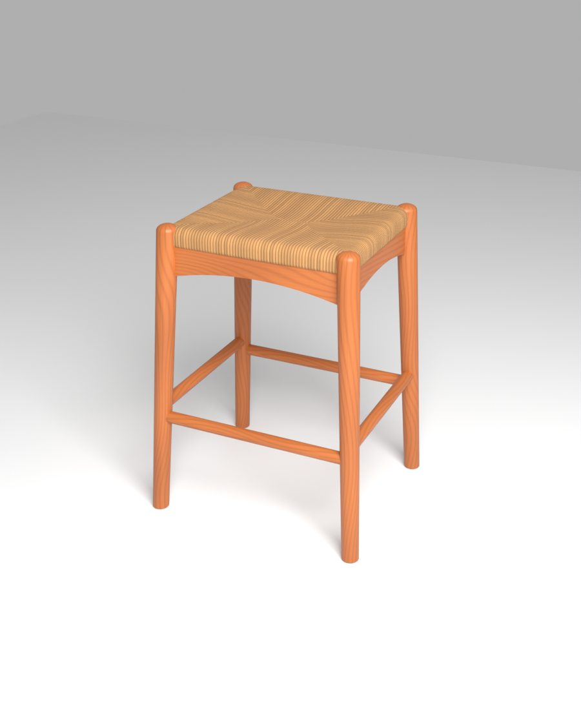

# كرسي بار بمقعد مجدول — جاهز لـ Lumion

## الملفات
| الملف | الاستخدام |
|---|---|
| `BarStool.fbx` | **الملف الأساسي للومين** (الخامات مدمجة بداخله) |
| `BarStool.obj` + `BarStool.mtl` | بديل، لازم يكون مجلد `textures` جنبه |
| `BarStool.blend` | ملف المصدر في Blender |
| `textures/` | خامة الخشب والحبل الورقي (Albedo + Normal) |
| `make_textures.py`, `build_stool.py` | سكربتات توليد الخامات والموديل (`pip install bpy`) |

## المواصفات
- الوحدة: **متر** — المقاس الحقيقي: عرض 48.6 × عمق 42.6 × ارتفاع 64.5 سم (ارتفاع الجلسة 64 سم، كرسي كاونتر).
- نقطة الارتكاز (Pivot) في منتصف الأرضية تحت الكرسي، فينزل على الأرض مباشرة.
- موديل واحد (Object واحد) بخامتين: `Stool_Wood` و `Stool_PaperCord`.
- 4,434 vertex فقط — خفيف ومناسب لتكراره حول جزيرة مطبخ.
- كل الأسطح مغلقة، الـ normals للخارج، ما في أسطح متطابقة (No Z‑fighting)، UV حقيقي بالمقاس.
- نقشة الجدل (4 مثلثات تلتقي بخط في المنتصف) مبنية بالـ UV نفسه، فتطلع صحيحة من أي زاوية.

## الاستيراد في Lumion
1. **Import** ← Import new model ← اختر `BarStool.fbx`.
2. تأكد أن الارتفاع ≈ 0.645 م (يظهر عند تحديد الموديل). لو طلع مكبّر ×100، أعد الاستيراد بـ `BarStool.obj`.
3. في محرر الخامات (Materials) لكل خامة اختر **Standard** وحط:

| الخامة | Color map | Normal map | Gloss / Reflectivity | Relief |
|---|---|---|---|---|
| `Stool_Wood` | `Wood_Albedo.jpg` | `Wood_Normal.png` | 0.35 / 0.25 | 0.4 |
| `Stool_PaperCord` | `Rush_Albedo.jpg` | `Rush_Normal.png` | 0.10 / 0.05 | 1.0 |

> Lumion أحياناً يقرأ الـ Color فقط من FBX، فلو ما شفت التضاريس في الحبل حط الـ Normal map يدوي من مجلد `textures`.
> لو تبغى لون خشب مختلف: من Standard material عدّل **Colorization** بدون ما تغير الخامة.
